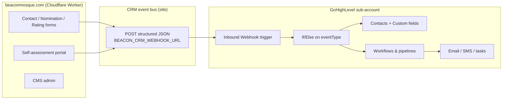
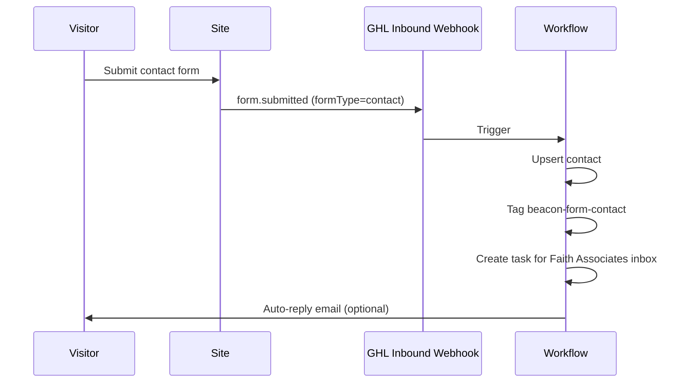
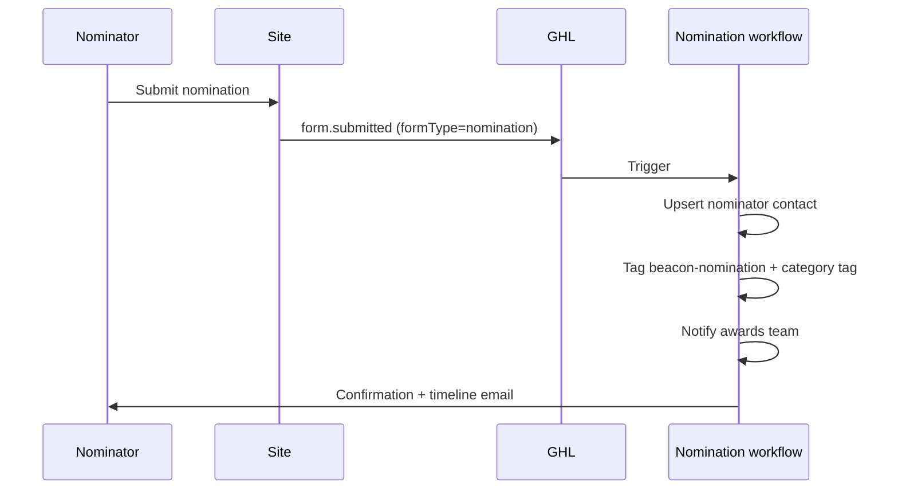
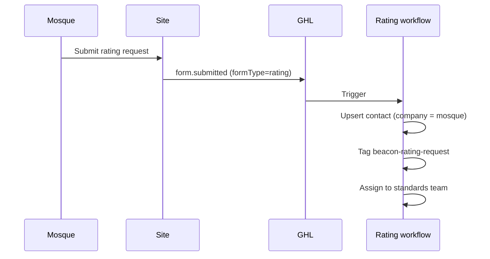
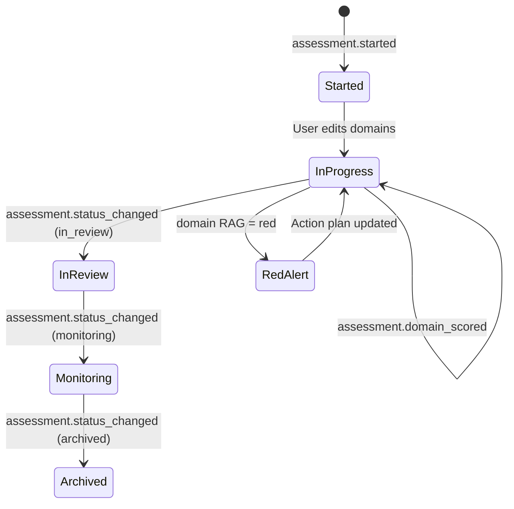

# Beacon Mosque × GoHighLevel automation

Working blueprint for connecting [beaconmosque.com](https://beaconmosque.com) to **GoHighLevel (GHL)** so Faith Associates can manage mosque relationships, follow-ups, and programme journeys from one CRM.

**Status:** Contact, nomination, and rating forms are embedded from GHL (`src/lib/ghl-forms.ts`). Safeguarding self-assessment events still post to the inbound webhook from the site.

---

## Public forms (GHL embed)

| Form | Where it appears | Config key |
|------|------------------|------------|
| Contact | `/contact-us/` | `ghlForms.contact.embedSrc` |
| Nomination 2026 | Closed — archive link only if needed | `ghlForms.nomination.href` |
| Public vote (2026) | Finalist profile pages (`/awards/beacon-mosque-awards-2026/finalist/…/`) | `ghlForms.voting.defaultEmbedSrc` or `ghlForms.voting.byCategory` |
| Mosque MBA enquiries | [mosque.mba](https://mosque.mba/) embed / cross-promo on finalist pages | `ghlForms.mosqueMba.embedSrc` |
| Mosque rating | `/ratings/` | `ghlForms.rating.embedSrc` |

Paste URLs from **GHL → Sites → Forms → Share** into `src/lib/ghl-forms.ts`, then redeploy. Submissions land directly in GHL — no site webhook needed for these forms.

---

## Goals

| Goal | How GHL helps |
|------|----------------|
| Capture every enquiry and nomination | Auto-create contacts, tag by intent, assign owner |
| Track safeguarding self-assessments | Mosque record + progress fields + nurture sequences |
| Trigger timely follow-up | Workflows on red/amber scores, stale packs, status changes |
| Reduce manual admin | Internal tasks, SMS/email templates, pipeline stages |

---

## System overview



The site **never stores CRM credentials in the browser**. Server-side code posts normalised events to a GHL **Inbound Webhook** URL (one URL, many event types).

---

## Event catalogue

| `eventType` | When it fires | Primary GHL action |
|-------------|---------------|-------------------|
| `form.submitted` | Contact, nomination, or rating form succeeds | Create/update contact, tag, notify team |
| `assessment.started` | New safeguarding pack created | Create mosque contact, send welcome + private link |
| `assessment.status_changed` | Pack moves draft → in_review → monitoring → archived | Pipeline stage, internal task |
| `assessment.domain_scored` | Domain RAG changes (red/amber/green) | Update custom fields; alert if red |

### Example payload (all events)

```json
{
  "eventType": "assessment.started",
  "eventId": "550e8400-e29b-41d4-a716-446655440000",
  "occurredAt": "2026-09-01T10:30:00.000Z",
  "source": "beaconmosque.com",
  "contact": {
    "firstName": "Aisha",
    "lastName": "Khan",
    "email": "safeguarding@examplemosque.org",
    "phone": "",
    "companyName": "Green Lane Masjid"
  },
  "tags": ["beacon-assessment", "programme-safeguarding"],
  "payload": {
    "packId": "…",
    "packStatus": "draft",
    "assessmentUrl": "https://beaconmosque.com/self-assessment/{token}/",
    "summary": { "red": 0, "amber": 0, "green": 0, "unset": 12 }
  }
}
```

GHL workflow mapping uses `{{inboundWebhook.contact.email}}`, `{{inboundWebhook.eventType}}`, etc.

---

## Automation flows (detailed)

### 1. Contact form



**Suggested tags:** `beacon-form-contact`, `source-website`

**Suggested custom fields:** `last_form_type`, `last_form_subject`, `last_form_message`

---

### 2. Awards nomination



**Suggested tags:** `beacon-nomination`, `category-{slug}` (e.g. `category-best-run-mosque`)

**Pipeline (optional):** Nomination received → Under review → Shortlisted → Winner

---

### 3. Mosque rating request



---

### 4. Safeguarding self-assessment lifecycle



| Stage | Workflow trigger | Recommended automation |
|-------|------------------|------------------------|
| Started | `assessment.started` | Welcome email with assessment link; tag `programme-safeguarding` |
| Domain scored red | `assessment.domain_scored` + `rag=red` | Internal alert to safeguarding lead; optional mosque check-in SMS |
| Domain scored amber | `assessment.domain_scored` + `rag=amber` | Add to 14-day nurture sequence (resources/training links) |
| Submitted for review | `assessment.status_changed` → `in_review` | Task for Faith Associates reviewer |
| Monitoring | `status_changed` → `monitoring` | Quarterly reminder workflow |
| Stale pack (no activity 30d) | GHL scheduled workflow | Re-engagement email (query by custom field `assessment_last_activity`) |

**Suggested custom fields (contact or custom object):**

| Field | Type | Source |
|-------|------|--------|
| `beacon_assessment_url` | Text | `payload.assessmentUrl` |
| `beacon_assessment_status` | Text | `payload.packStatus` |
| `beacon_rag_red_count` | Number | `payload.summary.red` |
| `beacon_rag_amber_count` | Number | `payload.summary.amber` |
| `beacon_rag_green_count` | Number | `payload.summary.green` |
| `beacon_mosque_name` | Text | `contact.companyName` |

---

## GHL setup checklist

### A. Environment (Cloudflare Worker secrets)

```bash
# Primary inbound webhook — create in GHL first (see B)
npx wrangler secret put BEACON_CRM_WEBHOOK_URL

# Optional: public site URL for assessment links in payloads
npx wrangler secret put BEACON_SITE_URL   # https://beaconmosque.com

# Legacy: separate form webhook still supported
npx wrangler secret put BEACON_FORM_WEBHOOK_URL
```

Local dev: add the same keys to `.dev.vars` (not committed).

### B. Create the inbound webhook in GHL

1. **Automation → Workflows → Create workflow**
2. Trigger: **Inbound Webhook**
3. Copy the webhook URL → set as `BEACON_CRM_WEBHOOK_URL`
4. Add **If/Else** branches on `eventType`:
   - `form.submitted` → form handler sub-workflow
   - `assessment.started` → assessment onboarding
   - `assessment.status_changed` → pipeline update
   - `assessment.domain_scored` → RAG alert branch (check `payload.rag`)

### C. Contact mapping (inside each branch)

| Site field | GHL contact field |
|------------|-------------------|
| `contact.firstName` | First name |
| `contact.lastName` | Last name |
| `contact.email` | Email |
| `contact.companyName` | Company / Business name |
| `tags[]` | Tags (add action) |

### D. Recommended tags

| Tag | Meaning |
|-----|---------|
| `beacon-website` | Any site interaction |
| `beacon-form-contact` | General enquiry |
| `beacon-nomination` | Awards nomination |
| `beacon-rating-request` | Mosque rating request |
| `beacon-assessment` | Safeguarding self-assessment participant |
| `programme-safeguarding` | Safeguarding programme track |
| `rag-red` | Has at least one red domain (set in domain_scored branch) |

---

## Out of scope (phase 2)

- **Bi-directional sync** (GHL → site) — would need authenticated API on the Worker
- **Training LMS enrolment** — link from assessment gaps once training portal ships
- **Martyn's Law portal** — same event pattern, new `programme-martyns-law` tags
- **Direct GHL API upsert** — optional; webhooks are sufficient for v1

---

## Feedback questions

Please review and confirm:

1. **Single webhook vs separate webhooks** per programme — current design uses one URL + `eventType` routing. Prefer separate URLs?
2. **Red/amber alerts** — who receives internal notifications (named users, round-robin, email alias)?
3. **Nomination pipeline** — do you want a full GHL opportunity pipeline or tags-only for 2026 cycle?
4. **Assessment link in email** — should GHL send the private token link, or only Faith Associates staff?
5. **Existing contacts** — merge by email, or always create new?

Once confirmed, wire the GHL workflow branches and set `BEACON_CRM_WEBHOOK_URL` on production.

---

## Code references

| File | Role |
|------|------|
| `src/lib/ghl-forms.ts` | GHL embed and link URLs for contact, nomination, rating |
| `src/lib/crm.ts` | Event types, normalisation, webhook dispatch (assessments) |
| `src/app/api/forms/route.ts` | Emits `form.submitted` |
| `src/app/api/assessment/packs/route.ts` | Emits `assessment.started` |
| `src/app/api/assessment/packs/[token]/route.ts` | Emits `assessment.status_changed` |
| `src/app/api/assessment/packs/[token]/domains/[domainId]/route.ts` | Emits `assessment.domain_scored` |
